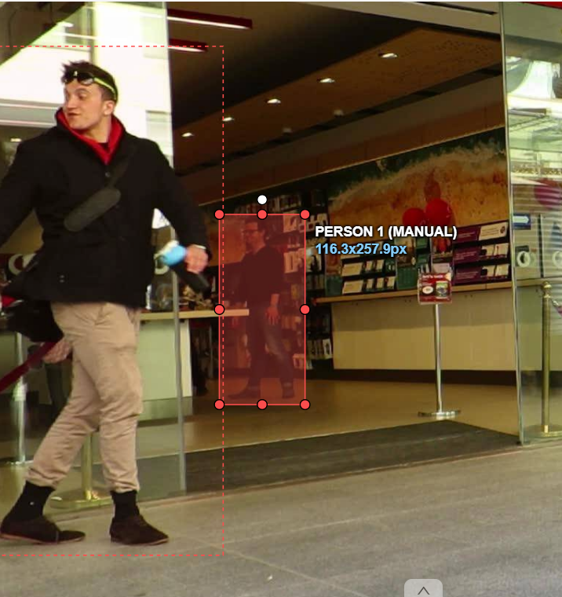
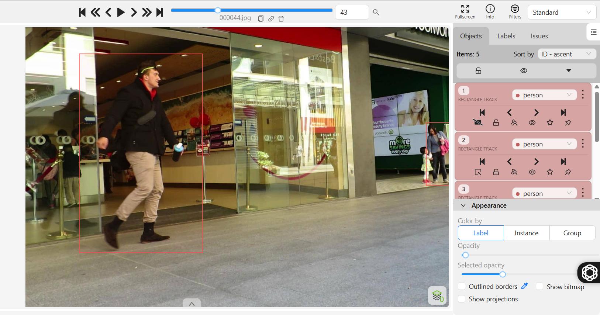
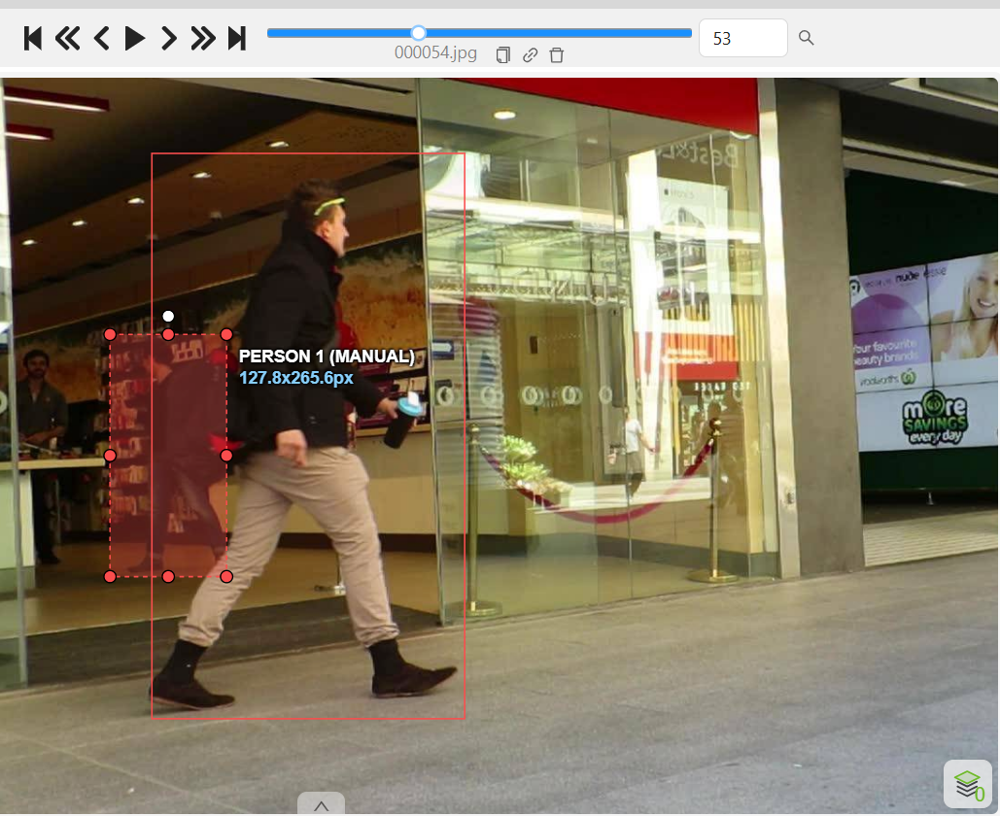

# Báo cáo cá nhân — Phạm Quang Huy - 2A20264055

Đoạn video: MOT17-09, 150 frame (frame 0–149 trên CVAT), nguồn MOTChallenge, giấy phép CC BY-NC-SA 3.0.

## 0. Thông tin học viên

- Họ tên: Phạm Quang Huy
- MSSV: 2A20264055
- Mã đề (A/B/C): C
- Email: huyde1357@gmail.com
- Link repository: https://github.com/feedfoot/K5-L2-Day06-PhamQuangHuy-2A20264055-MOTTracking
- Giờ bắt đầu: 2026-11-13
- Giờ kết thúc: 2026-11-13

## 1. Xem trước đoạn video (CP0)

Ghi **trước khi vẽ**, mỗi người một dòng.

| Mã | Frame xuất hiện | Frame cuối thấy được | Rẽ / dừng / đổi tốc độ ở frame | Bị che ở frame | Ghi chú |
|---|---|---|---|---|---|
| P1 | 0 | 149 | 25–31, 53–58, 85 | 42–43 (mất hẳn) | Đi từ trái sang, bị che bởi vật cản giữa đoạn |
| P2 | 0 | 149 | 67, 89–97, 107–116 | Không | Đi suốt 150 frame, đổi tốc độ nhiều lần |
| P3 | 0 | 106 | 40, 89–90 | Không | Ra khỏi khung hình sau frame 106 |
| P4 | 0 | 149 | 32–38, 66, 78, 86, 109 | 120–125, 137–148 | Bị che/outside hai đoạn cuối |
| P5 | 64 | 149 | 82–84, 127, 132–134 | Không | Xuất hiện muộn từ frame 64 |

## 2. Keyframe và thời gian (CP1, CP4)

Số keyframe lấy từ kết quả `src/check_submission.py`.

| Mã | Số keyframe | Keyframe ở frame | Số frame có mặt | Keyframe / 100 frame | Thời gian (phút) | Chỗ khó |
|---|---|---|---|---|---|---|
| P1 | 25 | 0, 10, 20, 25, 29, 30, 31, 40, 44, 50, 53, 57, 58, 60, 70, 80, 85, 90, 100, 106, 110, 120, 130, 140, 149 | 148 | 16.9 | ~10 | Đoạn bị che frame 42–43, đổi hướng quanh frame 25–31 |
| P2 | 26 | 0, 10, 18, 20, 30, 40, 50, 60, 67, 70, 80, 89, 90, 97, 100, 107, 109, 110, 116, 120, 125, 129, 130, 140, 144, 149 | 150 | 17.3 | ~10 | Đổi tốc độ nhiều lần, cần keyframe dày ở frame 89–116 |
| P3 | 6 | 0, 10, 20, 40, 89, 90 | 107 | 5.6 | ~5 | Ra khỏi khung hình sớm |
| P4 | 32 | 0, 4, 10, 13, 20, 30, 32, 33, 34, 35, 36, 37, 38, 40, 50, 60, 66, 70, 78, 80, 86, 90, 100, 109, 110, 126, 127, 130, 134, 135, 136, 149 | 132 | 24.2 | ~12 | Rẽ/dừng nhiều lần frame 32–38, bị outside hai đoạn cuối |
| P5 | 14 | 64, 74, 82, 83, 84, 94, 104, 114, 124, 127, 132, 134, 144, 149 | 86 | 16.3 | ~8 | Xuất hiện muộn, đổi hướng quanh frame 82–84 |
| **Tổng** | **103** | | **623** | **16.5** | **~45** | |

Keyframe / 100 frame của cả bài = 103 ÷ 623 × 100 = **16.5**

Bạn đặt keyframe nhiều nhất ở người nào? Vì sao (người đó rẽ, dừng, lại gần camera hay bị che)?

P4 có nhiều keyframe nhất (32 keyframe, 24.2/100 frame) vì người này rẽ và dừng nhiều lần trong đoạn frame 32–38, đồng thời có hai đoạn bị outside (frame 120–125 và 137–148) cần đặt keyframe trước và sau mỗi đoạn khuất.

## 3. Đoạn bị che (CP2)

Người bị che: `P1` (người mặc áo tối, quần kaki, đeo túi xách — bị người phụ nữ áo xanh che khuất)

| Mốc | Frame |
|---|---:|
| Bắt đầu bị che một phần (bật `occluded`) | 40 |
| Mất hẳn (bật `outside`) | 42 |
| Hiện lại (tắt `outside`) | 44 |
| Thấy rõ trở lại (tắt `occluded`) | 50 |

- Thời gian khuất hẳn: **2 frame** = 0.07 giây.
- Quyết định: **giữ cùng ID**.
- Lý do (trả lời 3 câu: khuất bao lâu so với 60 frame, ngoại hình có khớp, chỗ hiện lại có đúng hướng và tốc độ):

1. Khuất hẳn chỉ 2 frame (frame 42–43), rất ngắn so với ngưỡng 60 frame (2 giây).
2. Ngoại hình trước và sau đoạn che hoàn toàn khớp: cùng áo tối, quần kaki, túi xách đeo vai, dáng người và kích thước không đổi.
3. Chỗ hiện lại (frame 44) đúng hướng đi ban đầu và tốc độ tương đương — P1 tiếp tục đi qua phía sau người phụ nữ áo xanh.

Ảnh chụp màn hình:





## 4. Tự review ID (CP3)

Lượt 1 theo người (đi ngược từ frame 149 về 0 trên CVAT), lượt 2 theo cảnh (nhảy 10 frame). Ít nhất 3 dòng; không có lỗi thì ghi một dòng "đã kiểm hai lượt, không lỗi".

Loại lỗi dùng đúng một trong 7 mã: `id_switch`, `fragmentation`, `lost`, `merge`, `false_track`, `drift`, `flag`.

| Frame | Mã người | Loại lỗi | Mô tả một câu | Phát hiện ở lượt | Đã sửa? |
|---:|---|---|---|---|---|
| 35 | P4 | `drift` | Box bị trôi nhẹ khi P4 đổi hướng liên tục frame 32–38 | Lượt 1 | Có, thêm keyframe |
| 42 | P1 | `flag` | Cần kiểm tra cờ occluded/outside đúng đoạn khi P1 bị che | Lượt 1 | Có, chỉnh cờ |
| 90 | P3 | `drift` | Box nội suy trôi nhẹ trước khi P3 ra khỏi khung | Lượt 2 | Có, thêm keyframe tại frame 89–90 |

Tổng hợp số lỗi theo loại:

| `id_switch` | `fragmentation` | `lost` | `merge` | `false_track` | `drift` | `flag` |
|---:|---:|---:|---:|---:|---:|---:|
| 0 | 0 | 0 | 0 | 0 | 2 | 1 |

Lỗi nào chỉ lượt 2 (theo cảnh) mới thấy, lượt 1 (theo người) không thấy? Vì sao?

Lỗi `drift` ở P3 frame 90 chỉ phát hiện ở lượt 2 vì khi nhìn tổng thể cảnh mới thấy box P3 lệch so với vị trí thực, trong khi lượt 1 chỉ tập trung một người nên dễ bỏ qua sự trôi nhẹ.

## 5. File xuất và kết quả tự kiểm (CP4)

| Kiểm tra | Kết quả |
|---|---|
| Tên file MOT 1.1 | PhamQuangHuy_mot.zip |
| Tên file CVAT for video 1.1 | PhamQuangHuy_cvat_video.zip |
| Số track ID khác nhau trong `gt/gt.txt` (phải là 5) | 5 |
| Frame `outside` không có dòng trong `gt.txt` (đúng / sai) | Đúng |
| Job đã completed trên CVAT máy cá nhân | Có |

Dán phần tóm tắt in ra từ `src/check_submission.py`:

```text
Số frame in theo CVAT (bắt đầu từ 0). Trong gt.txt, frame_id = frame CVAT + 1.

=== File MOT 1.1: PhamQuangHuy_mot.zip ===
  Số track ID: 5   |   Tổng số box: 623
  [OK]        Đúng 5 track ID.

  Track | Frame có mặt | Số frame | Đoạn vắng (outside)
      1 |   0–149      |      148 | 42–43
      2 |   0–149      |      150 | -
      3 |   0–106      |      107 | -
      4 |   0–149      |      132 | 120–125, 137–148
      5 |  64–149      |       86 | -

=== File CVAT for video 1.1: PhamQuangHuy_cvat_video.zip ===

  Track | Nhãn   | Frame thấy | Keyframe | KF/100 frame | Frame occluded | Lần bật outside
      0 | person |        148 |       25 |         16.9 |             52 |               1
      1 | person |        150 |       26 |         17.3 |             67 |               0
      2 | person |        107 |        6 |          5.6 |             18 |               1
      3 | person |        132 |       32 |         24.2 |             60 |               2
      4 | person |         86 |       14 |         16.3 |             40 |               0

  Tổng: 103 keyframe / 623 frame có mặt = 16.5 keyframe / 100 frame
  [OK]        Đọc được 5 track từ annotations.xml.

=== Tóm tắt ===
  Lỗi: 0   |   Cảnh báo: 0
  Đạt. Dán phần tóm tắt này vào báo cáo mục 5.
```

## 6. Ba câu kết

1. Nếu được gán lại, bạn sẽ đặt keyframe khác ở đâu? Vì sao?

   Sẽ đặt thêm keyframe ở P3 trong đoạn frame 40–89 vì hiện tại chỉ có 6 keyframe cho 107 frame, khoảng cách giữa hai keyframe quá xa (frame 40 đến 89) khiến box có thể trôi. Ngoài ra sẽ giảm keyframe ở P4 đoạn frame 32–38 (hiện có keyframe gần như mỗi frame) vì có thể nội suy đủ chính xác với ít keyframe hơn.

2. Có chỗ nào bạn không chắc "cùng ID hay ID mới"? Bạn đã quyết định và ghi chú thế nào?

   Đoạn P1 bị che ở frame 42–43 chỉ khuất 2 frame (rất ngắn so với ngưỡng 60 frame), ngoại hình và hướng đi khớp hoàn toàn nên quyết định giữ cùng ID. Đoạn P4 bị outside ở frame 120–125 (6 frame) và 137–148 (12 frame), cả hai đều dưới ngưỡng 60 frame nên giữ cùng ID.

3. Một lỗi ID trong job của bạn (nếu không còn sót, chọn lỗi đã sửa) có thể làm xe tự lái dự đoán sai chuyển động của người đó như thế nào? Lỗi đó ảnh hưởng MOTA hay IDF1 nhiều hơn?

   Lỗi `drift` ở P4 frame 35: nếu box trôi khỏi người, xe tự lái sẽ ước tính sai vị trí người đi bộ, dẫn đến dự đoán quỹ đạo sai (ví dụ tưởng người đứng yên trong khi thực tế đang rẽ). Lỗi drift ảnh hưởng MOTA nhiều hơn vì khi IoU giữa box gán và ground truth rơi dưới 0.5, box đó bị tính là FP (false positive) và GT bị tính là FN (false negative), trực tiếp giảm MOTA. IDF1 ít bị ảnh hưởng hơn vì ID vẫn đúng người, chỉ vị trí box bị lệch.

## Bonus (nếu làm)

Không làm.

## 7. Tài liệu tham khảo và công cụ AI đã dùng

- Dữ liệu: MOT17, MOTChallenge (Milan et al., 2016), giấy phép CC BY-NC-SA 3.0.
- Công cụ AI: Claude Code — hỗ trợ tra cứu cách dùng CVAT (phím tắt, cấu hình), giải thích khái niệm occluded/outside, chạy script tự kiểm `check_submission.py`, và hỗ trợ viết báo cáo.

